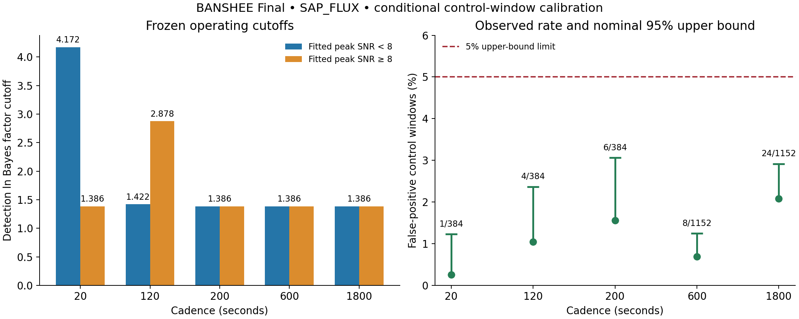

# BANSHEE

**Bayesian Analysis of Stellar High-energy Eruption Events**

Stellar-flare detection and measurement for TESS light curves. The current
standalone release is **[BANSHEE_Final.py](BANSHEE_Final/BANSHEE_Final.py)**,
version **2026.11.16.edge1**. It includes local-noise screening, flare-protected
detrending, exposure-integrated flare models, and saved SAP calibration cuts.

[Full run guide](BANSHEE_Final/README.txt) |
[Changes since Lite_Chi](BANSHEE_Final/CHANGES_SINCE_LITE_CHI.txt) |
[Validation](BANSHEE_Final/VALIDATION.txt) |
[Final cadence cutoffs](BANSHEE_Final/CUTOFFS_FINAL.txt) |
[Legacy Lite_Chi guide](README_LITE_CHI.md)

## Installation

Use Python **3.11–3.13** on Linux or macOS; Windows users require WSL.
The complete portable release is in the `BANSHEE_Final` folder.

```bash
git clone https://github.com/Logan-J-Snyder/BANSHEE.git
cd BANSHEE/BANSHEE_Final
python3 -m venv .venv
source .venv/bin/activate
python -m pip install -r requirements.txt
python BANSHEE_Final.py --version
```

Dependencies are installed once. The detector reads local inputs and can run
offline afterward. No archive account is needed. This project is not on PyPI;
an unrelated package named `banshee` is not this code.

## Quick Start

Generate artificial examples at all five supported calibration cadences:

```bash
python make_example_lightcurves.py --output ./example_lightcurves
python -u BANSHEE_Final.py \
  --input ./example_lightcurves --output-dir ./example_results \
  --workers 2 --plots
```

For your own light curves:

```bash
python -u BANSHEE_Final.py \
  --input /path/to/lightcurves --output-dir /path/to/results --workers 4
```

Each FITS, CSV or Parquet input must represent one star, sector and flux stream.
Keep inputs and outputs in separate, non-nested folders. Automatic loading
prefers `SAP_FLUX`; add `--flux-column SAP_FLUX` to require it explicitly.

No new calibration run is needed for matching built-in SAP settings. All five
default cadence groups passed their stated checks. The November 10 fixed-cut
confirmation passed at 600s and 1800s with nominal 95% upper false-window bounds
of 1.25% and 2.92%; otherwise passing 1800s events can now be accepted. Other
streams, exposures or changed settings do not automatically inherit validation. See the [run guide](BANSHEE_Final/README.txt)
for exact cuts, calibration scope, server-layout mode, tmux and resume instructions.

## Detection and Outputs

- Three-sigma candidate thresholds follow changing local noise.
- Flare models compete with background, reversed-flare, symmetric-bump and
  impulse alternatives, with additional raw-flux and morphology checks.
- Edge candidates are fitted and classified. The outer 1% carries an independent
  `edge_case` flag.
- Accepted, follow-up, rejected and complete diagnostic tables are written as
  CSV and Parquet. Optional plots support review.
- Progress reports elapsed time and processed jobs. Recoverable file failures
  are recorded while the batch continues; a failed batch returns a nonzero
  status after preserving successful products.

Use [backfill_edge_candidates.py](BANSHEE_Final/backfill_edge_candidates.py)
to refit skipped edge candidates from an earlier run and write merged Parquets.
The [run guide](BANSHEE_Final/README.txt) describes the required saved products.

The optional advisory precheck runs before fitting and does not change
detection tiers:

```bash
python -u BANSHEE_Final_With_Precheck.py \
  --input /path/to/lightcurves --output-dir /path/to/results --workers 4
```

Detection and parameter usability remain separate. Inspect `parameter_usable`
before population measurements. TESS-band flare energy is not bolometric energy.
The calibration's 5% false-alarm target is per tested control window, not a 5%
contamination guarantee for a survey flare catalog.

## Validation and History

The updated release passed **89 local regression tests** and the five-cadence
CLI example. Scientific functions and numerical cuts are unchanged; embedded
calibration evidence and the 1800s validation status were updated. The fixed
confirmation completed 3,064 planned trials with zero failures on reused local
background stars. Earlier resume, failure-continuation and advisory-wrapper
checks are documented in the November 9 release history.



From the `BANSHEE_Final` directory:

```bash
python -m unittest discover -s tests -v
```

These checks establish operation and source equivalence, not population
completeness or independent real-data accuracy. See the
[validation record](BANSHEE_Final/VALIDATION.txt) and
[release manifest](BANSHEE_Final/RELEASE_MANIFEST.json).

`BANSHEE_Lite_Chi.py`, its installed `banshee-lite-chi` command, tests and original
guides remain available. The root `pyproject.toml` and `docs/` guides describe
that legacy interface; use the self-contained Final folder for the current
detector. Existing results and calibration files are not interchangeable
between these versions. See the [legacy guide](README_LITE_CHI.md).

## References and Reuse

Method references include [Tovar Mendoza et al. (2022)](https://arxiv.org/abs/2205.05706),
[Pitkin et al. (2014)](https://arxiv.org/abs/1406.1712), and
[Ilin & Poppenhaeger (2022)](https://doi.org/10.1093/mnras/stac1232).
These sources do not independently validate this implementation or its empirical
thresholds. Use GitHub's citation metadata for the software version used and
cite the relevant method papers separately.

**Copyright (c) 2026 Logan Snyder. All rights reserved.** Use and reuse require
prior written permission, subject to the exceptions in [LICENSE](LICENSE).
Installation instructions are provided for authorized users. Third-party
dependencies retain their own terms.
