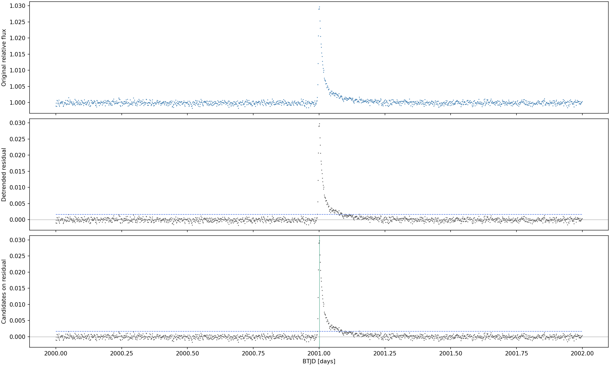

# BANSHEE

**Bayesian Analysis of Stellar High-energy Eruption Events**

Stellar-flare detection and measurement for TESS light curves. This repository
contains **`BANSHEE_Lite_Chi.py`**: broad-grid Bayesian detection followed by
continuous chi-square parameter fitting with an exposure-averaged
**Tovar Mendoza et al. (2022)** flare template.

[Quick start](#quick-start) | [Inputs and outputs](docs/inputs-and-outputs.md) |
[Flags](docs/flags.md) | [Method](docs/method.md) | [Batch processing](docs/batch-processing.md)

## Features

- Reads one-dimensional FITS, CSV, or Parquet light curves.
- Detrends by default, or accepts explicitly identified pre-detrended inputs.
- Seeds candidates at 3 sigma, then compares flare, reversed-flare, and artifact hypotheses.
- Keeps **accepted**, **follow-up**, and **rejected** candidates in separate tables.
- Fits peak time and FWHM continuously; solves nonnegative amplitude and a linear baseline analytically.
- Calculates equivalent duration (ED), and TESS-band energy when calibrated.

This is the **Chi version**, not the experimental Test/Updated code. It retains
the original classification rules, including candidate-overflow follow-up.
Detection and parameter usability are separate: an accepted event can have
unreliable measurements.

## Installation

Requires **Python 3.11+**, on **Linux or macOS**. The server interface imports Unix
`fcntl`; Windows users should use **WSL2/Linux**, not native Windows.

```bash
git clone https://github.com/Logan-J-Snyder/BANSHEE.git
cd BANSHEE
python3 -m venv .venv
source .venv/bin/activate
python -m pip install --upgrade pip
python -m pip install -e ".[dev]"
```

Alternatively, install `requirements.txt` and run the script directly. This project
is not on PyPI; an unrelated package named `banshee` is not this code. Direct
dependency versions used locally are in [requirements-tested.txt](requirements-tested.txt).
Numerical-library threads are limited to one by the module when imported.

## Quick Start

Generate a reproducible synthetic 2-minute light curve and run the detector:

```bash
python examples/make_demo_lightcurve.py --output-dir demo_data
python BANSHEE_Lite_Chi.py \
  --input demo_data/0000000000000000000_S01_SPOC_demo.csv \
  --output-dir results/demo \
  --already-detrended --flux-column flux \
  --tess-band-luminosity 1e30 --plots
python examples/summarize_results.py results/demo
```

The demo is already flat apart from noise and the flare. Its flux is centered near
**one**, not zero: **do not add `--residual`** to this example. Its all-zero source
ID and luminosity are synthetic placeholders, not measurements of a real star.
No archive account or network query is needed for this demo.



This matching-template demonstration checks operation, not survey completeness
or independent scientific accuracy. Generated inputs and results remain local.

## Usage

### A FITS Light Curve

```bash
python BANSHEE_Lite_Chi.py \
  --input /path/to/lightcurve.fits --output-dir results/my_star --plots
```

Detrending is enabled here. Default flux preference starts with `PDCSAP_FLUX`,
then `KSPSAP_FLUX`, `SAP_FLUX`, `raw_flux`, or `flux`. Select a column explicitly
with `--flux-column COLUMN_NAME`. Pipeline-corrected flux is not detector raw pixels.

### A Folder, Four Workers

```bash
python BANSHEE_Lite_Chi.py \
  --input /path/to/lightcurves --output-dir results/batch \
  --workers 4 --candidate-workers 1
```

Folders are searched recursively. Keep stellar catalogues and prior outputs
**outside** the input folder. Start with one file before a batch. For the audited
OC/FS input tree and resumable runs, see [batch processing](docs/batch-processing.md).

### Already-Detrended Zero-Centered Residuals

```bash
python BANSHEE_Lite_Chi.py \
  --input /path/to/residual.csv --output-dir results/residual \
  --already-detrended --residual --flux-column residual_flux
```

### Python API

```python
from pathlib import Path
import BANSHEE_Lite_Chi as banshee

config = banshee.Config()  # Detrending and chi-square fitting enabled.
lightcurve = banshee.load_lightcurve(Path("/path/to/lightcurve.fits"), config)
events, prepared, fits, diagnostics = banshee.analyze(lightcurve, config)
accepted = events.loc[events["tier"] == "accepted"]
if "parameter_usable" in accepted:
    usable = accepted.loc[accepted["parameter_usable"].fillna(False)]
else:
    usable = accepted.iloc[:0]  # No characterized candidates.
```

For file writing and calibration, use the CLI or
`run_file((input_path, output_dir, config, plots))`. The API is currently the
standalone module, not a separate stable public package interface.

## Output

| Combined file | Contents |
|---|---|
| `accepted_flares.csv` | Accepted detections, including measurement warnings |
| `followup_flares.csv` | Ambiguous, incomplete, failed, or overflow candidates |
| `rejected_candidates.csv` | Rejected seeds, not all non-flaring observations |
| `runtimes.csv` | Per-file status, timing, and errors in ordinary mode |
| `manifest.json` | Configuration and hashes in ordinary mode |

Per-input folders retain full `all_events.csv`, `summary.json`, and optional
plots/`prepared.npz`. Combined tables omit some diagnostics: use `all_events.csv`
for complete decisions. `E_TESS = ED_seconds * L_TESS_erg_per_second`; missing
calibration leaves energy missing. TESS-band energy is not bolometric energy.
`*_bayesian_p16/p50/p84` are **not** error bars on continuous chi-square estimates.
See [scientific limitations](docs/method.md) before interpreting measurements.

## Project Structure

```text
BANSHEE/
  BANSHEE_Lite_Chi.py       # Standalone scientific implementation
  banshee_cli.py            # Installed command wrapper
  pyproject.toml            # Installation metadata and dependencies
  requirements*.txt        # Dependency ranges and tested snapshot
  examples/                # Synthetic generator and result summary
  docs/                    # Input/output, method, flag, and batch guides
  tests/                   # Offline regression and command-line tests
  .github/                 # CI and issue / pull-request templates
  CITATION.cff             # Software citation metadata
  PROVENANCE.json          # Source hashes and packaging-only changes
```

## Tests

```bash
python -m pytest
banshee-lite-chi --help
banshee-lite-chi --server --help
```

Tests cover exposure averaging, continuous fits, fallback, quality filtering,
exact IDs, exports, and a command-line smoke run. They do not establish survey-wide
sensitivity or accuracy on every morphology. See [contributing](CONTRIBUTING.md).

## References and Reuse

The shape follows [Tovar Mendoza et al. (2022)](https://arxiv.org/abs/2205.05706).
Bayesian detection is motivated by [Pitkin et al. (2014)](https://arxiv.org/abs/1406.1712).
The detrending implementation is based on
[Ilin & Poppenhaeger (2022)](https://doi.org/10.1093/mnras/stac1232).
These sources do not independently validate our implementation, thresholds, or
usability flags. See [method and references](docs/method.md).

Use GitHub's **Cite this repository** metadata for the software, and cite the
relevant method papers separately.

**Copyright (c) 2026 Logan Snyder. All rights reserved.** This is not an
open-source license: use and reuse require prior written permission, subject to
the exceptions in [LICENSE](LICENSE). Installation instructions and examples are
provided for authorized users. Third-party dependencies retain their own terms.
