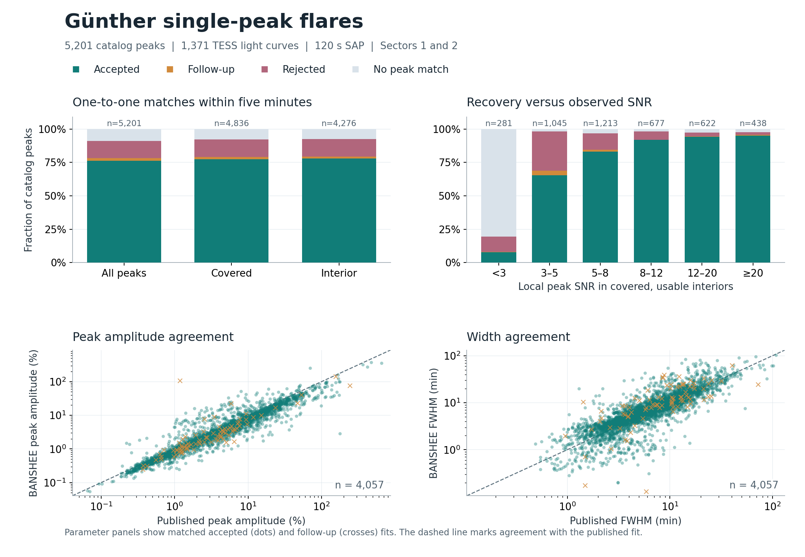

# Günther single-peak flares

BANSHEE Final `2026.11.16.edge1` (detector commit `fa6a587`) searched the entire quality-filtered native 120 s SAP light curve for each of the 1,371 target–sector pairs containing a single-peak entry in Günther et al. Table 1. This sample includes all 5,201 catalog components whose outbursts have exactly one component in the full 8,695-row table. [Günther et al. (2020), §III](https://arxiv.org/html/1901.00443v2#S3) · [VizieR Table 1](https://vizier.cds.unistra.fr/viz-bin/VizieR?-source=J/AJ/159/60/table1)



| Catalog peaks | Total | Accepted | Follow-up | Rejected | No peak match |
| --- | ---: | ---: | ---: | ---: | ---: |
| All single peaks | 5,201 | 3,971 (76.4%) | 96 (1.8%) | 671 | 463 |
| Covered peaks | 4,836 | 3,735 (77.2%) | 90 (1.9%) | 632 | 379 |
| Covered, usable interior peaks | 4,276 | 3,335 (78.0%) | 61 (1.4%) | 555 | 325 |
| Interior peaks with observed SNR ≥8 | 1,737 | 1,623 (93.4%) | 6 (0.3%) | 67 | 41 |

Among the 3,971 accepted fits, the median BANSHEE-to-catalog amplitude ratio was 0.83 and the median FWHM ratio was 1.15. The match and fit statistics are in [summary.json](summary.json).

[Browse all 1,134 missed peaks](missed_peaks/README.md), with one PNG per event and indexes by sector and outcome.

## Method

- The detector used the built-in SAP calibration with no published peak times, widths, or amplitudes supplied at detection time. It ran on each full sector. The paper starts from PDC-SAP and applies additional detrending, so the fit comparisons include differences in flux products, preprocessing and flare models. [Paper method](https://arxiv.org/html/1901.00443v2#S3)
- Matching used the full set of published components on those sectors, so nearby components from complex outbursts competed for detections. Within each target and sector, the match maximized one-to-one pairs in accepted, follow-up, then rejected order, minimizing absolute time separation within each tier. A fitted peak was preferred and the seed was used where no fitted peak was available. The main tolerance was ±5 min, with ±2 and ±10 min sensitivity checks in [summary.json](summary.json).
- A covered catalog peak has a retained observation in a valid segment within 0.75 cadence of its published time. The interior subset additionally excludes locations marked as detrending edges or with uncertain background. Observed SNR is the maximum of the locally baseline-subtracted detrended residual divided by BANSHEE local noise within one cadence of the published peak. It uses observed measurements at catalog locations, while the injection benchmark uses known injected SNR.
- The lower panels show agreement of positive fitted amplitudes and FWHM for matched accepted and follow-up fits. A catalog peak without a match can fall in an observation gap, miss candidate selection, or have a fitted peak outside the matching window. The benchmark measures recovery of published labels. It does not estimate false positives among unmatched BANSHEE detections.

## Reproduce

Run from the repository root with the dependencies in `requirements.txt`. The downloads total about 3 GB. The runner caches the FITS and writes each completed sector atomically so the same command can resume after interruption.

```sh
work=validation_local/guenther
mkdir -p "$work"
curl -fL 'https://vizier.cds.unistra.fr/viz-bin/asu-tsv?-source=J/AJ/159/60/table1&-out=TIC,Sec,Outbst,Flare,tpeak,Amp,FWHMdt&-out.max=unlimited' -o "$work/published_catalog.tsv"
curl -fL 'https://archive.stsci.edu/missions/tess/download_scripts/sector/tesscurl_sector_1_lc.sh' -o "$work/sector1.sh"
curl -fL 'https://archive.stsci.edu/missions/tess/download_scripts/sector/tesscurl_sector_2_lc.sh' -o "$work/sector2.sh"
python validation/guenther_single_peaks/run_catalog.py \
  --catalog "$work/published_catalog.tsv" --indices "$work/sector1.sh" "$work/sector2.sh" \
  --cache "$work/fits" --output "$work" --download --workers 8
python validation/guenther_single_peaks/plot_catalog.py "$work"
python validation/guenther_single_peaks/plot_misses.py "$work" \
  --search-root "$work/fits" --output "$work/missed_peaks"
```

[Run configuration and input hashes](protocol.json) · [Per-light-curve source manifest](source_manifest.json) · [SNR-bin recovery counts](recovery_by_snr.csv)
