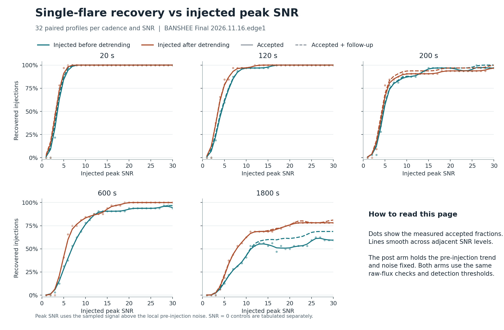

# Injection recovery before and after detrending

BANSHEE Final `2026.11.16.edge1` (detector commit `fa6a587`) was tested on five native cadences using its built-in calibrated SAP cutoffs.



[Efficiency and all 1:1 plots in one PDF](injection_recovery_1to1.pdf)

| Cadence | 1:1 parameter plots | Accepted before detrending | Accepted after detrending | Accepted or follow-up before | Accepted or follow-up after |
| --- | --- | ---: | ---: | ---: | ---: |
| 20 s | [PNG](one_to_one_20s.png) | 100.0% | 100.0% | 100.0% | 100.0% |
| 120 s | [PNG](one_to_one_120s.png) | 99.1% | 99.7% | 99.1% | 99.7% |
| 200 s | [PNG](one_to_one_200s.png) | 94.6% | 92.9% | 95.8% | 96.0% |
| 600 s | [PNG](one_to_one_600s.png) | 91.4% | 96.0% | 91.5% | 96.0% |
| 1800 s | [PNG](one_to_one_1800s.png) | 54.5% | 73.8% | 61.8% | 74.6% |

The table uses the 672 injections per cadence and arm with peak SNR 10–30. [Exact counts at every positive SNR](recovery_by_snr.csv), [parameter and recovery summaries](recovery_summary.csv), and [zero-SNR controls](zero_snr_controls.csv) are available as CSVs.

## Method

- The same 32 profiles were sampled at 20, 120, 200, 600, and 1800 s, at integer peak SNR from 0 through 30. This gives 9,600 positive trials plus 160 zero-SNR controls shared by the two arms.
- Widths span 1.07–48.79 min and sample quantiles of the 5,201 positive single-component FWHM values in Günther et al. Table 1. All flares use the detector's own exposure-integrated Tovar template family with three rise stretches. [Günther et al. (2020)](https://doi.org/10.3847/1538-3881/ab5d3a) · [Tovar Mendoza et al. (2022)](https://arxiv.org/abs/2205.05706)
- Each pair uses the same location and profile in a roughly 1–2 day window from one of 40 real SAP light curves, drawn from 17 stars. Some light curves were previously used in detector calibration. Locations retain at least 99.6% of model fluence inside the 5% margins around light-curve edges and gaps. Locations with an existing local peak at or above 3σ near the proposed peak were screened out.
- The pre-detrending arm adds the signal to SAP flux and re-estimates detrending and noise. The post-detrending arm adds the paired signal to the residual with the original trend, protection mask, local baseline, and local noise frozen. Both arms see the same injected SAP series for raw-flux checks. Injected peak SNR is the exposure-averaged signal at its brightest sampled point divided by the original local total noise at that point.
- Fits search the window near each injection, within the larger of four cadences or three injected FWHM. Matches require a fitted peak or seed within the larger of two cadences or one FWHM. The 1:1 plots show matched accepted and follow-up fits with a positive fitted value. The efficiency curves smooth the measured fractions across adjacent SNR levels. No zero-SNR control had an accepted or follow-up match at its screened location.

## Reproduce

The [frozen plan](plan.json) records the 40 source filenames and SHA-256 hashes, quality-filtered window indices, placement parameters, and detector and catalog hashes. The input FITS are required to repeat this exact experiment. Use the curated SAP FITS with the recorded hashes, since different preprocessing changes the window indices and local noise. The original run and this portable runner use the same trial implementation.

From the repository root with the recorded detector version and dependencies installed.

```sh
python validation/injection_recovery/run_injections.py --inputs /path/to/source_fits --output validation_local/injections
python validation/injection_recovery/plot_recovery.py validation_local/injections
```
